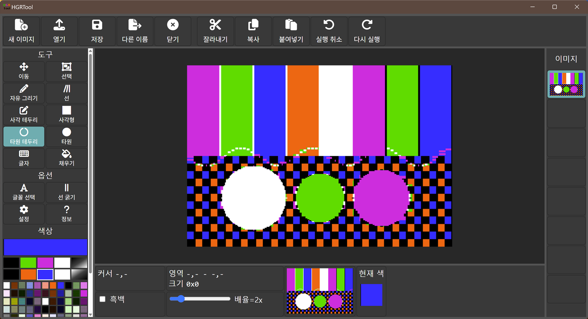
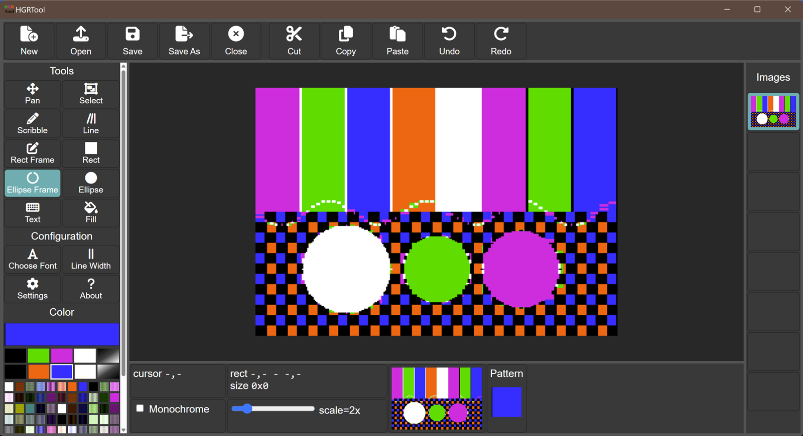

# HGRTool Desktop

**한국어** | [English](README_en.md)

Apple II 고해상도(HGR) 그래픽 편집기 **HGRTool**의 휴대용 데스크톱 버전입니다. 브라우저를 띄우지 않고
자체 창에서 실행되며, 실행 파일 하나로 배포됩니다. 항상 보이는 색상 팔레트가 추가되었습니다.
**영어판**과 **한국어판**(메뉴, 대화상자, 메시지가 모두 한국어) 두 가지로 빌드됩니다.



*Windows의 한국어판(`hgrtool-ko.exe`). 색상 팔레트(왼쪽 막대 아래쪽)는 항상 보입니다. 선택한 색은 흰색 테두리로
강조되고, 위쪽의 큰 상자와 아래쪽의 "현재 색" 상자에 표시됩니다. 화면의 이미지는 직접 생성한 데모 화면입니다.*



*영어판(`hgrtool.exe`): 인터페이스만 영어인 같은 프로그램입니다.*

이 프로젝트는 Andy McFadden의 HGRTool을 바탕으로 한 파생 저작물입니다. 편집기 자체(모든 그리기 도구, 파일
형식 처리, 렌더링)는 그의 코드이며, 이 프로젝트는 그것을 데스크톱 셸로 감싸고 문서화된 소소한 변경을 더했습니다.

## 원본 프로젝트와 출처

| | |
|---|---|
| **원본 프로젝트** | HGRTool, https://github.com/fadden/HGRTool |
| **원저작자** | Andy McFadden (faddenSoft), Copyright 2025 faddenSoft |
| **원본 라이선스** | Apache License 2.0 (코드), CC BY-SA 4.0 (이미지와 문서) |
| **관련 도구** | BMP2htr, https://www.appleoldies.ca/ (비트맵을 HGR로 변환하는 도구이며 이 프로젝트에 포함되지 않음) |

원본의 저작권 고지는 그대로 유지됩니다. 편집기 소스 파일의 Apache 2.0 헤더가 남아 있고, 정보(About) 창과 그
법적 고지에도 "Copyright 2025 faddenSoft"와 외부 구성 요소의 출처가 계속 표시됩니다.

## 원본과 달라진 점

원본 HGRTool은 브라우저에서 여는 웹 페이지입니다(웹 서버, 또는 여기서 쓰는 번들 사본과 인터넷 아이콘 글꼴이
필요합니다). 이 프로젝트는 그 페이지를 `hgrtool-local/`에 **수정하지 않은 채** 보관하고, 그 **사본**에 패치를
적용해 데스크톱 앱을 만듭니다.

**추가된 것**
- 시스템 웹 뷰를 감싸는 네이티브 창(Python + [pywebview](https://pywebview.flowrl.com/))이며, PyInstaller로
  실행 파일 하나로 묶었습니다. 실행하는 데 Python이 설치되어 있을 필요가 없습니다.
- **한국어판**(`hgrtool-ko.exe`). 한국어 텍스트는 빌드할 때 페이지 사본에 적용됩니다: 메뉴, 도구 이름, 툴팁,
  대화상자, 메시지, 네이티브 파일 대화상자, 저장하지 않은 변경 사항 확인 창. (정보 창의 법적 고지는 영어
  그대로입니다.) 두 버전은 같은 코드에서 만들어집니다.
- 네이티브 열기/저장 대화상자. 파일을 직접 읽고 씁니다(8192바이트 원시 `.hgr` 화면, 브라우저 버전의 출력과 동일).
- 브라우저의 `localStorage` 대신 파일(`hgrtool-data/settings.json`)에 저장되는 설정.
- 저장하지 않은 변경 사항이 있을 때 창을 닫으면 확인하는 창.
- 명령줄에서 파일 열기: `hgrtool file.hgr`.
- **항상 보이는 색상 팔레트**(아래 참조).
- 빌드 스크립트, 단위 테스트, 내장 스모크 테스트(`hgrtool --selftest`).

**편집기 페이지에서 바뀐 것**(빌드할 때 사본에 자동 적용됩니다. 전체 목록은 `src/tools/patch_web.py`,
`src/tools/translations.py`, `ARCHITECTURE.md` 참조)
- "색 선택" 팝업 대화상자를 없앴습니다. 색 견본이 왼쪽 막대로 옮겨졌고 현재 색을 보여 주는 큰 상자가 생겼습니다.
  견본을 한 번 클릭하면 선택됩니다.
- 팔레트 공간을 만들려고 왼쪽 막대를 더 작게(도구 버튼을 작게) 만들었고, 창이 낮으면 스크롤됩니다.
- `localStorage` 설정 접근을 설정 파일로 바꿨고, 더 이상 의미 없는 "견본 클릭 시 색 대화상자 닫기" 설정은 숨겼습니다.
- 정보 창에 데스크톱 래퍼의 버전도 표시됩니다.
- 저장하지 않은 변경 사항 확인과 셀프 테스트를 위한 몇 가지 훅(`window.__hgr`)을 노출했습니다.
- 한국어판에서는 사용자에게 보이는 텍스트가 번역됩니다.

**바뀌지 않은 것**: 그리기 도구, 렌더링, 108색 팔레트, 실행 취소/다시 실행, 클립, 글자, 파일 형식.
`hgrtool-local/` 자체는 절대 수정되지 않으며, 빌드 전후에 체크섬으로 확인합니다.

## 다운로드 / 빌드

**바로 받아서 쓰기**: 빌드된 실행 파일이 이 저장소의 [`dist/`](dist) 폴더에 들어 있습니다(Windows). 원하는
파일을 받아 아무 폴더에서나 실행하면 됩니다. 설치가 필요 없습니다.

직접 빌드하려면: Windows에서 `build_all.bat`을 실행하면 두 버전이 `dist\`에 만들어집니다.

| 파일 | 언어 |
|---|---|
| `dist\hgrtool.exe` | 영어 |
| `dist\hgrtool-ko.exe` | 한국어 |

자세한 내용, 필요한 도구, macOS/Linux 절차는 [BUILD.md](BUILD.md)에 있고, 동작 방식은
[ARCHITECTURE.md](ARCHITECTURE.md)에 있습니다.

**실행**에 필요한 것(Windows): Microsoft Edge WebView2 런타임(Windows 11에는 기본 설치됨).
macOS와 Linux 빌드는 제공되지만 아직 테스트하지 않았습니다.

## 저장소 구성

```
hgrtool-local/   원본 웹 앱(수정하지 않은 로컬 사본: HTML, CSS, Font Awesome, 파비콘)
src/             데스크톱 래퍼: Python 패키지, 웹 오버레이, 번역, 빌드 도구, 테스트
docs/            스크린샷
build_all.bat    Windows 빌드 (macOS/Linux는 build_all.sh)
dist/            빌드된 실행 파일 (Windows): hgrtool.exe(영어), hgrtool-ko.exe(한국어)
LICENSE          Apache License 2.0
LICENSES.txt     외부 구성 요소 고지
*.md / *_en.md   문서: 한국어(기본)와 영어(_en)
```

`hgrtool-local/`은 원본 웹 앱의 로컬 번들입니다(그 폴더의 README에 따르면 원본에서 번들 스크립트로 만들었으며,
그 스크립트는 이 저장소에 포함되어 있지 않습니다).

## 문서 언어

모든 문서는 두 가지 버전이 있습니다. 한국어 버전이 기본이라 이름에 접미사가 없고, 영어 버전은 `_en`이 붙습니다.

| 한국어 (기본) | 영어 |
|---|---|
| [README.md](README.md) | [README_en.md](README_en.md) |
| [ARCHITECTURE.md](ARCHITECTURE.md) | [ARCHITECTURE_en.md](ARCHITECTURE_en.md) |
| [BUILD.md](BUILD.md) | [BUILD_en.md](BUILD_en.md) |

한쪽을 고칠 때는 다른 쪽도 함께 갱신해 주세요.

## 라이선스

- 이 프로젝트의 새 코드(`src/` 아래 전부와 빌드 스크립트, 한국어 번역 포함)는 원본과 같은
  **Apache License 2.0**으로 배포됩니다. [LICENSE](LICENSE)를 참조하세요.
- `hgrtool-local/`의 원본 HGRTool 코드는 원래의 **Apache License 2.0**과 저작권(c) 2025 faddenSoft가
  그대로 유지됩니다. 원본의 이미지와 문서는 CC BY-SA 4.0입니다.
- 함께 들어 있는 외부 구성 요소(Graphics Magician 팔레트, Font Awesome Free, Alois Zingl의 타원 그리기 코드,
  Python, pywebview 등)와 그 라이선스는 [LICENSES.txt](LICENSES.txt)에 있으며, `dist/`의 실행 파일 옆에도
  복사됩니다.

Apache 2.0 제4조에 따라 라이선스 전문(`LICENSE`)을 포함하고, 변경된 파일을 위 설명과 `ARCHITECTURE.md`에
밝혔으며, 원본의 저작권·특허·상표·출처 고지를 유지합니다.

## 제휴 관계 없음

이 프로젝트는 독립 프로젝트이며 원저작자의 보증을 받은 것이 아닙니다.
