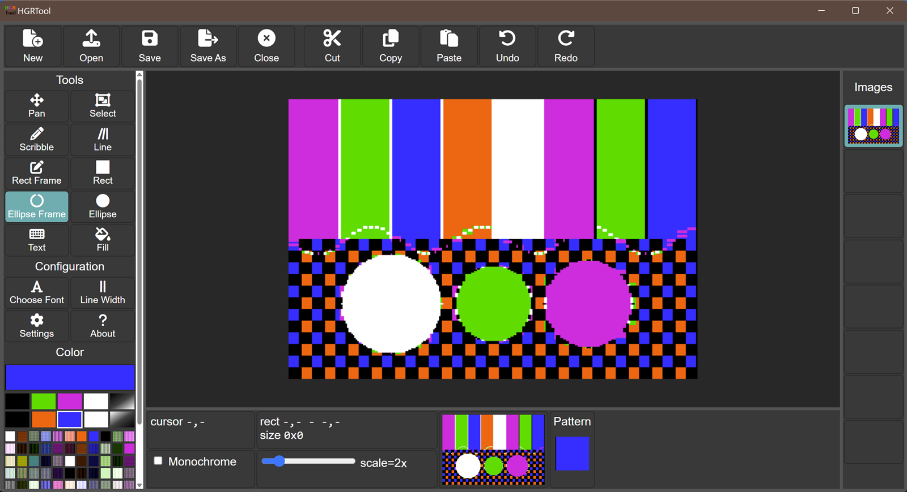
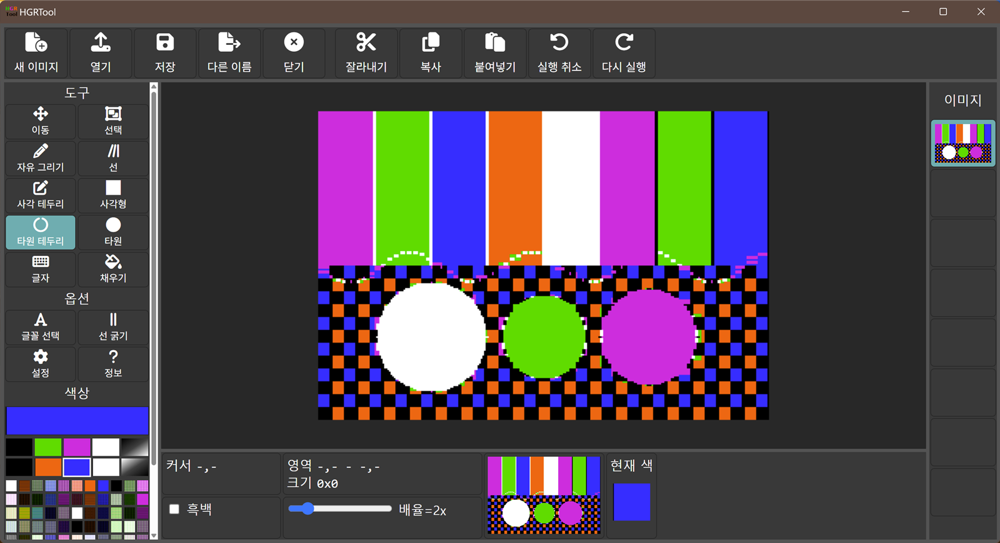

# HGRTool Desktop

[한국어](README.md) | **English**

A portable desktop version of **HGRTool**, an editor for Apple II hi-res (HGR) graphics. It runs in its own
native window (no browser to launch) as a single executable, and adds an always-visible color palette.
It is built in two versions: **English** and **Korean** (all menus, dialogs and messages in Korean).



*English version on Windows. The color palette (bottom of the left bar) is always visible; the selected color is
outlined in white and shown in the large box above it and in the "Pattern" box at the bottom. The image shown is a
generated demo screen.*



*Korean version (`hgrtool-ko.exe`): the same program with a Korean interface.*

This project is a derivative work of HGRTool by Andy McFadden. The editor itself (all drawing tools, file
format handling and rendering) is his code; this project wraps it in a desktop shell and makes small,
documented changes.

## Original project and credit

| | |
|---|---|
| **Original project** | HGRTool, https://github.com/fadden/HGRTool |
| **Original author** | Andy McFadden (faddenSoft), Copyright 2025 faddenSoft |
| **Original license** | Apache License 2.0 (code); CC BY-SA 4.0 (images and documentation) |
| **Related tool** | BMP2htr, https://www.appleoldies.ca/ (for converting bitmaps to HGR; not part of this project) |

The upstream copyright notices are kept: the editor's source files retain their Apache 2.0 headers, and the
About box (and its legal text) still shows "Copyright 2025 faddenSoft" and the third-party credits.

## What is different from upstream

Upstream HGRTool is a web page that you open in a browser (it needs a web server, or the bundled copy used
here, plus an internet icon font). This project keeps that page unchanged on disk in `hgrtool-local/` and
builds the desktop apps from patched **copies** of it.

**Added**
- A native window (Python + [pywebview](https://pywebview.flowrl.com/)) around the system web view, packaged
  as one executable with PyInstaller. Python does not need to be installed to run it.
- A **Korean version** (`hgrtool-ko.exe`). The Korean text is applied at build time to a copy of the page:
  menus, tool names, tooltips, dialogs, messages, the native file dialogs and the unsaved-changes prompt.
  (The legal text in the About box stays in English.) Both versions come from the same code.
- Native Open / Save dialogs. Files are read and written directly (raw 8192-byte `.hgr` screens, identical to
  the browser version's output).
- Settings saved to a file (`hgrtool-data/settings.json`) instead of the browser's `localStorage`.
- A prompt when closing the window with unsaved changes.
- Opening files from the command line: `hgrtool file.hgr`.
- An **always-visible color palette** (see below).
- Build scripts, unit tests and a built-in smoke test (`hgrtool --selftest`).

**Changed in the editor page** (applied automatically at build time to a copy; see `src/tools/patch_web.py`,
`src/tools/translations.py` and `ARCHITECTURE_en.md` for the full list)
- The "Choose Color" pop-up dialog is removed. Its swatches now live in the left bar, with a large
  current-color box. One click on a swatch selects it.
- The left bar is more compact (smaller tool buttons) to make room for the palette, and scrolls on short windows.
- `localStorage` settings access is redirected to the settings file; the obsolete "close the color dialog on
  single/double click" setting is hidden.
- The About box also shows the desktop wrapper version.
- A few hooks are exposed (`window.__hgr`) for the unsaved-changes prompt and the self-test.
- In the Korean version, the user-visible texts are translated.

**Not changed**: the drawing tools, rendering, the 108-entry color palette, undo/redo, clipping, text, file
format. `hgrtool-local/` itself is never modified; the build verifies its checksums before and after.

## Download / build

Windows: run `build_all.bat`; it builds both versions into `dist\`:

| File | Language |
|---|---|
| `dist\hgrtool.exe` | English |
| `dist\hgrtool-ko.exe` | Korean (한국어) |

Details, tools and the macOS / Linux steps are in [BUILD_en.md](BUILD_en.md). How it works is in
[ARCHITECTURE_en.md](ARCHITECTURE_en.md).

Requirements to **run** (Windows): the Microsoft Edge WebView2 runtime (preinstalled on Windows 11).
macOS and Linux builds are provided but untested.

## Repository layout

```
hgrtool-local/   upstream web app (unmodified local copy: HTML, CSS, Font Awesome, favicon)
src/             desktop wrapper: Python package, web overlay, translations, build tools, tests
docs/            screenshots
build_all.bat    build on Windows (build_all.sh for macOS / Linux)
dist/            build output (not committed)
LICENSE          Apache License 2.0
LICENSES.txt     third-party notices
*.md / *_en.md   documentation: Korean (default) and English (_en)
```

`hgrtool-local/` is a local bundle of the upstream web app (its own README notes it was produced by a bundling
script from the original; that script is not part of this repository).

## Documentation languages

Every document has two versions. The Korean version has the plain name and is the default; the English one has
the suffix `_en`:

| Korean (default) | English |
|---|---|
| [README.md](README.md) | [README_en.md](README_en.md) |
| [ARCHITECTURE.md](ARCHITECTURE.md) | [ARCHITECTURE_en.md](ARCHITECTURE_en.md) |
| [BUILD.md](BUILD.md) | [BUILD_en.md](BUILD_en.md) |

When you change one version, please update the other as well.

## License

- This project's new code (everything under `src/` and the build scripts, including the Korean translations)
  is released under the **Apache License 2.0**, the same license as upstream. See [LICENSE](LICENSE).
- The upstream HGRTool code in `hgrtool-local/` remains under its original **Apache License 2.0** and
  copyright (c) 2025 faddenSoft. Upstream images and documentation are CC BY-SA 4.0.
- Bundled third-party components (the Graphics Magician palette, Font Awesome Free, Alois Zingl's ellipse
  code, Python, pywebview and others) are listed with their licenses in [LICENSES.txt](LICENSES.txt),
  which is also copied next to the executables in `dist/`.

As required by Apache 2.0 section 4: the License is included (`LICENSE`), changed files are identified above and
in `ARCHITECTURE_en.md`, and original copyright, patent, trademark and attribution notices are retained.

## Not affiliated

This is an independent project and is not endorsed by the original author.
